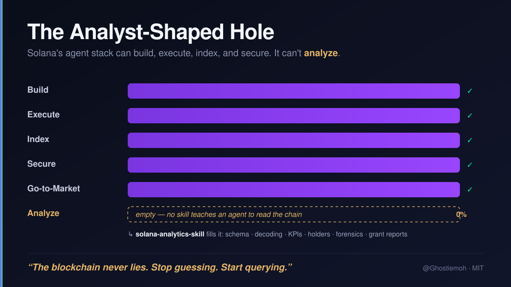

# solana-analytics-skill

**Turn any coding agent into a senior Solana on-chain data analyst.**

[](LICENSE)
[](.github/workflows/ci.yml)
[](#)



> *"The blockchain never lies. Stop guessing. Start querying."*, [@Ghostieemoh](https://github.com/Ghostiemoh)

A progressive, token-efficient skill for the [Solana AI Kit](https://github.com/solanabr/solana-ai-kit).
It takes an agent from raw account/log data all the way to **decoded tables → KPIs → holder &
forensics reads → dashboards → grant-ready reports**, and it can actually run the queries it writes.

### Launch documents
* [Launch Article: Why Solana agents cannot read on-chain data](docs/launch/article.md)
* [Launch Report: Solana AI Kit analytics specification and verification](docs/launch/report.md)

---

## The problem it solves

Solana's agent stack can *build* programs, *execute* trades, *index* events, and *audit* code. It
**cannot reason about on-chain data.** Ask any existing skill "is this protocol actually growing,"
"who really holds this token," "is this volume wash-traded," or "give me metrics for my grant
report," and there's no good answer:

- **Price/trading APIs** (Birdeye, CoinGecko, GMGN) give you the *last price*, not the schema, the
  metric, or the analysis.
- **Execution kits** (SendAI) *do* things, but they don't measure them.
- **Indexers** ingest data into your own database, but they don't tell you what to ask of it.
- **Generic SQL/data-science skills** know SQL but nothing about `dex_solana.trades`, Anchor
  discriminators, decimals, or both-legs double-counting.

The analyst layer is the gap. This skill fills it, and it's the only one in the ecosystem that
teaches an agent the **Solana-native schema and metric**, then validates the result.

## Where it fits (and where it doesn't)

| This skill **is** | This skill is **not** |
| --- | --- |
| The analysis layer: query, interpret, report | An indexer/pipeline (that ingests) |
| Solana-native schema + KPI + forensics knowledge | A price/trading API wrapper |
| Dune/Flipside SQL + Helius DAS, validated | A generic SQL skill with no chain context |
| Risk & due-diligence forensics (defensive) | A program auditor (use an auditor skill) |

## What it does

- **Writes & optimizes** Dune/Flipside SQL from 22 tested, parameterized templates.
- **Decodes programs**. Anchor IDL/log decoding into analytics tables (the part nobody documents),
  with a built-in Anchor discriminator deriver.
- **Computes protocol KPIs**. TVL, volume, fees, revenue, DAU/WAU/MAU, retention, cohorts, share.
- **Analyzes DeFi by vertical**. DEX/CLMM, lending (utilization, liquidations, bad debt), LST
  (de-peg), perps (OI, funding).
- **Profiles holders & wallets**, distribution, whale/retail/bot segmentation, smart-money PnL.
- **Runs forensics**, wash-trade, rug-risk, sybil clusters, MEV/sandwich, fund tracing, as risk
  scores with confidence, never accusations.
- **Produces grant/fundraising reports**, durable metrics, organic-vs-incentivized splits, CAC/LTV
  proxies, the honesty appendix that wins reviewers.
- **Builds dashboards**, the 10-step playbook and four archetypes, delivered as a paste-ready build
  package.

## Repository structure

```
solana-analytics-skill/
├── SKILL.md                 # entry point, routes by intent (progressive loading)
├── CLAUDE.md                # agent identity, model routing, operator-first philosophy
├── references/              # focused, load-on-demand knowledge
│   ├── 01-data-sources.md       # Dune Spellbook / Flipside / Helius DAS schema
│   ├── 02-decoding.md           # logs + Anchor IDL → analytics tables
│   ├── 03-protocol-kpis.md      # TVL, volume, fees, DAU, retention, cohorts, share
│   ├── 04-defi-analytics.md     # DEX, lending, LST, perps metric families
│   ├── 05-holder-wallet.md      # distribution, segmentation, smart money
│   ├── 06-forensics.md          # wash, rug, sybil, MEV, fund tracing
│   ├── 07-growth-reporting.md   # grant/fundraising reports
│   ├── 08-dashboard-build.md    # 10-step build + archetypes
│   ├── 09-execution-playbook.md # operator mode: MCP → dune_run.py → paste-ready
│   └── resources.md             # table cheat-sheet, IDL registries, links
├── assets/
│   ├── dune-query-library.sql   # 22 runnable, parameterized templates
│   └── dashboard-spec-template.md
├── scripts/
│   ├── dune_run.py              # dependency-free Dune client + Anchor discriminator
│   └── test_dune_run.py         # offline unit tests (12, no API key needed)
├── agents/                  # analytics-architect (opus), sql-engineer, forensics-analyst
├── commands/                # /analyze-protocol /build-dashboard /holder-report /detect-wash-trades /growth-report
├── rules/                   # sql-conventions.md (auto-loading standards)
├── .mcp.json                # executable layer: Dune + Helius MCP (env-keyed)
├── install.sh / install-custom.sh / install.ps1
└── .github/workflows/ci.yml
```

## Installation

```bash
# Standard (installs to ~/.claude/skills/solana-analytics)
./install.sh -y

# Custom location (personal or project)
./install-custom.sh --project /path/to/repo --name solana-analytics

# Windows (PowerShell)
.\install.ps1 -Yes
```

Or drop the folder into your kit's `skills/` directory, `SKILL.md` is the entry point and
auto-routes.

## Executable layer (the differentiator)

Most analytics skills hand you SQL and stop. This one **runs it.** Two paths, MCP-first with graceful
fallback, the skill works fully even with neither:

1. **Dune MCP** (`.mcp.json`), run queries and fetch results live. Set `DUNE_API_KEY`.
2. **Helius MCP** (`.mcp.json`), live current-state checks (mint/freeze authority for rug checks,
   token accounts, DAS metadata). Set `HELIUS_API_KEY`.
3. **`scripts/dune_run.py`**, dependency-free fallback (`validate` / `create` / `run` / `results`)
   when no MCP is connected.
4. **Paste-ready**, if nothing is wired, queries are delivered runnable and labelled "not yet
   executed," with the exact command to run them.

```bash
export DUNE_API_KEY=..        # enables live execution + validation
export HELIUS_API_KEY=..      # enables live state checks

python scripts/dune_run.py validate query.sql --params params.json
python scripts/dune_run.py discriminator global swap   # -> 0xf8c69e91e17587c8
```

> The `.mcp.json` server endpoints/packages point at the official Dune and Helius MCP servers. They
> move fast, confirm the current command/URL from their docs (`references/resources.md`) and pin a
> version. **No secrets are committed**; keys are read from the environment.

## Usage examples

```
"Which DEX is winning on Solana this month?"          → market-share analysis (template 11)
"Find the top holders of <mint> and the risk."        → /holder-report <mint> <decimals>
"Is this token's volume real or wash-traded?"         → /detect-wash-trades <project>
"Give me metrics for my Foundation grant."            → /growth-report <project>
"Build me a Token-Health dashboard for <mint>."       → /build-dashboard <mint> token-health
"How many times is this instruction called per day?"  → decode (02) + template 22
```

## Agents & commands

| Agent | Model | Use for |
| --- | --- | --- |
| `analytics-architect` | opus | design metrics/schema, plan dashboards, source selection |
| `sql-engineer` | sonnet | author/optimize/validate a specific query |
| `forensics-analyst` | sonnet | wash/rug/sybil/MEV/fund-tracing risk work |

| Command | Does |
| --- | --- |
| `/analyze-protocol` | the validated protocol-health one-pager |
| `/build-dashboard` | a Dune dashboard build package |
| `/holder-report` | holder distribution + concentration risk |
| `/detect-wash-trades` | wash/manipulation assessment with a wash score |
| `/growth-report` | grant/fundraising report from on-chain data |

## Tested

`python -m unittest discover -s scripts -p "test_*.py"`, 12 offline tests (Anchor discriminator
vectors, payload building, param loading); no API key needed. CI also checks structural integrity and
that no placeholder/slop tokens ship in the SQL. See [.github/workflows/ci.yml](.github/workflows/ci.yml).

## Design principles

- **Progressive / token-efficient**, `SKILL.md` routes; heavy material loads only when its intent
  fires.
- **Operator-first**, delivers validated artifacts, not lectures.
- **Honesty floor**, never fabricates results; flags wallet ≠ user, realized PnL, window-dependent
  share, reconstruction timeouts.
- **Clean & safe**. MIT, dependency-free script, env-keyed MCP, no opaque binaries.

## On my portfolio

- Listed with my other work at [ghostiemoh.com](https://ghostiemoh.com/#work)

## Credits & license

Built by **Muhammad Auwal Abdul Aziz** ([@Ghostieemoh](https://github.com/Ghostiemoh)), on-chain &
data analyst. The query library and methodology are reverse-engineered from 8 professional Dune
dashboards (dune, cryptokoryo, 21sharesresearch, web3precious), see `references/resources.md`.

MIT licensed, free to merge or submodule into the Solana AI Kit.
